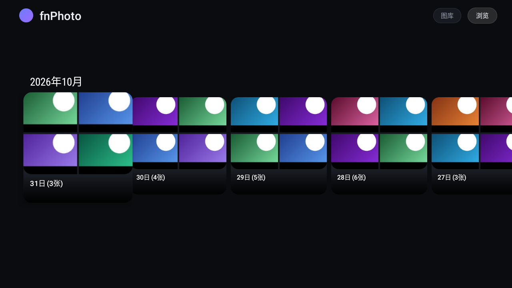
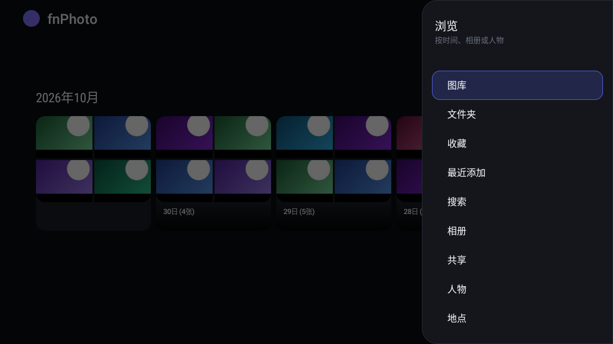
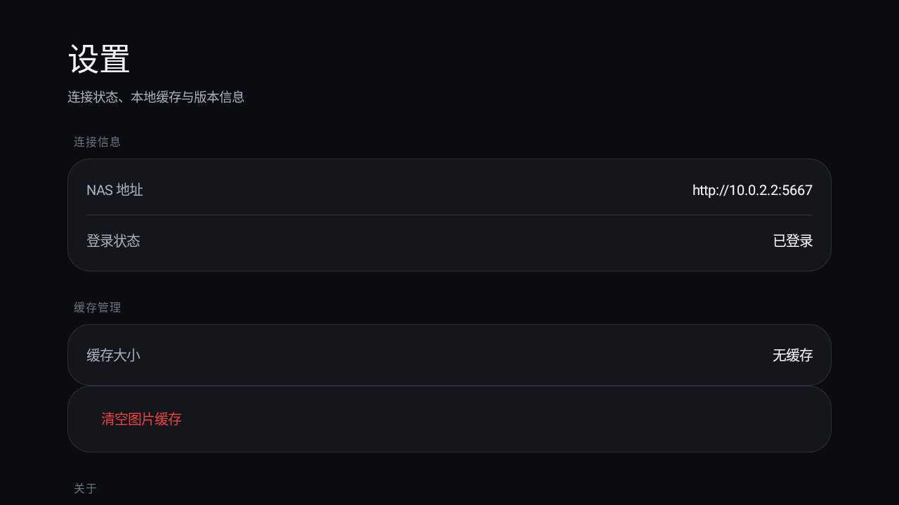
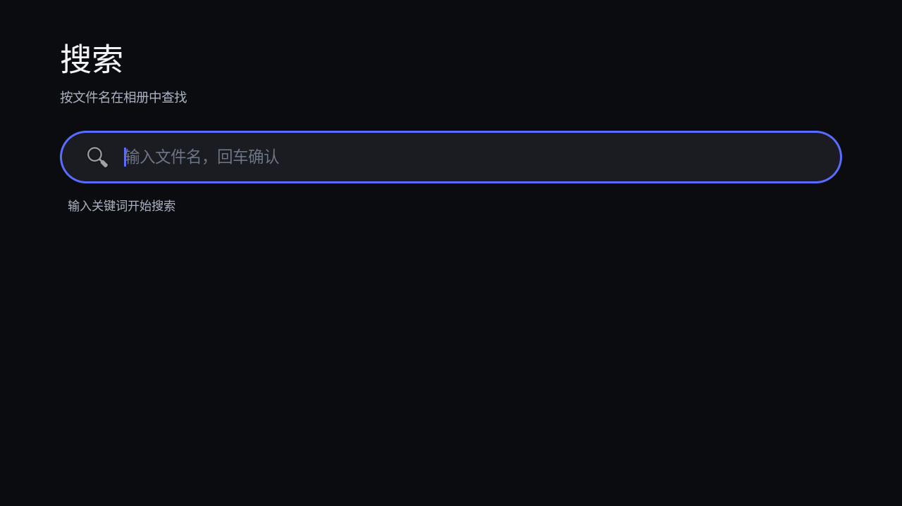
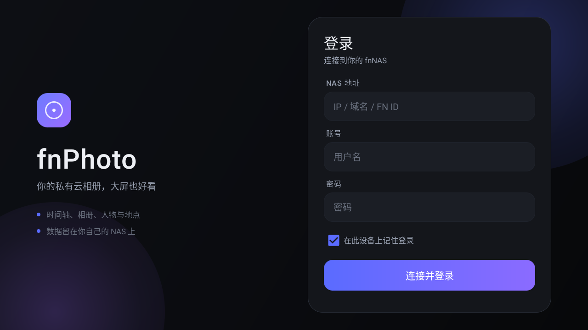

# fnPhoto TV

[简体中文](README.md) · **English**

An Android TV application for browsing photos and videos from FN NAS (fnOS) photo gallery.

## App screenshots

These existing application screenshots show synthetic test content, with no real user photos or accounts. They were added in the [UI redesign commit `4133a81`](https://github.com/aOrz/fnphoto-tv/commit/4133a81ffac85ae14860f6da9f4493e713fd753b) and predate later updates on main, so details such as focus styling may differ. They do not identify a released build or establish compatibility with a real NAS.

**Gallery timeline**



| Remote navigation | Settings and cache management |
| --- | --- |
|  |  |

| Filename search | NAS login |
| --- | --- |
|  |  |

The `10.0.2.2` address in the settings screenshot connects an emulator to its host for testing. Enter your own NAS address for normal use.

## Features

- **FN Connect Support**: Login via FN ID (cloud), local IP, or domain — auto-discovers reachable NAS
- **Timeline View**: Browse photos organized by date in a timeline format
- **Folder View**: Navigate through managed folders
- **Album View**: Browse user-created albums
- **Shared Albums**: Browse albums shared to you, with paged photo/video viewing and retryable loading ([contract and limits](docs/shared-albums.md))
- **Media Playback**: View photos and play videos with full-screen support
- **Seamless Navigation**: Use TV remote to navigate between photos with left/right keys
- **Fullscreen Experience**: Distraction-free viewing without system UI
- **TLS 1.2 on API 19**: Bundled Conscrypt + Mozilla CA bundle for secure HTTPS on older devices

## Requirements

- Android TV or Android device with API level 19+ (Android 4.4)
- Feiniu NAS (fnOS) running photo gallery service
- Network access to your NAS through a local IP on the same LAN, a reachable domain, or FN ID

## Installation

Building requires JDK 11, Android SDK Platform 29, and Build Tools 30.0.3. Configure `JAVA_HOME` and `ANDROID_HOME`; see the [CI instructions](.github/CI.md) for environment details.

1. Clone the repository:

```bash
git clone https://github.com/aOrz/fnphoto-tv.git
cd fnphoto-tv
```

2. Build the project using Android Studio or Gradle:

```bash
bash ./gradlew :app:assembleDebug
```

3. Connect `adb` to your Android TV with debugging enabled, then install the APK:

```bash
adb devices
adb install -r app/build/outputs/apk/debug/app-debug.apk
```

If multiple devices are connected, use `adb -s <serial> install -r ...` to select the target. These commands produce a debug APK; see the [CI instructions](.github/CI.md) for downloading CI debug artifacts.

## Authentication

This application uses the authentication mechanism from [fnnas-api](https://github.com/FNOSP/fnnas-api) by FNOSP. The authentication flow involves:

1. WebSocket-based login to obtain access token
2. Request signing using API key and secret
3. A random nonce and timestamp included in the signature

See [API.md](API.md) for detailed authentication documentation.

## Usage

1. **First Launch**: Enter FN ID, local IP, or domain, then your username and password
2. **Timeline Navigation**: Browse photos by date, grouped by year and month
3. **Side Menu**: Press MENU or select “浏览” (Browse) at the top right to access folders, albums, and settings
4. **Photo Viewing**: Click a date to view all photos from that day
5. **Media Details**: Click a photo/video to view in full screen
6. **Navigation**: Use LEFT/RIGHT keys to switch between photos in detail view
7. **Back and Exit**: BACK closes the menu or returns to the previous level first; at the main browsing level, press BACK twice within two seconds to exit

## Architecture

- **LoginActivity**: Login screen as the launcher activity
- **MainActivity**: Main entry point with side drawer navigation
- **MainFragment**: BrowseSupportFragment for displaying photo grids
- **MediaDetailActivity**: Full-screen photo/video viewer, using ExoPlayer for video playback
- **PhotoDetailActivity**: Standalone full-screen photo viewer
- **CardPresenter**: Custom presenter for photo thumbnails
- **FnAuthUtils**: Authentication and request signing utilities
- **FnHttpApi**: Retrofit interface for NAS API communication
- **FnConnectApi**: FN Connect cloud API client — FN ID lookup, authx signing, TCP probing with priority-based parallel delays
- **TlsUtils**: Conscrypt SSL provider + bundled Mozilla CA bundle for TLS 1.2 on API 19
- **FnWebSocketClient / FnWebSocketManager**: WebSocket-based login flow
- **ApiInterceptor / Reauthenticator**: Re-login, token renewal, and request re-signing after authentication failures

## API Integration

The app communicates with Feiniu NAS photo gallery API endpoints:

- `/p/api/v1/gallery/timeline` — Get timeline data
- `/p/api/v1/gallery/getList` — Get photos by date range
- `/p/api/v1/photo/folder/list` — Get managed folders
- `/p/api/v1/folder_view/getFolderList`, `/p/api/v1/folder_view/getFileList` — Get subfolders and files
- `/p/api/v1/album/list` — Get albums
- `/p/api/v1/album_grant/list_to_me`, `/p/api/v1/album/normal/getList` — Get albums shared to you and their contents
- `/p/api/v1/stream/p/t/{id}/{variant}/{uuid}` — Load images using returned URLs or the appropriate size path
- `/p/api/v1/stream/v/{id}` — Play videos

Photo gallery API requests use the `accesstoken` and `authx` headers. See [FnHttpApi.java](app/src/main/java/com/fnphoto/tv/api/FnHttpApi.java) for endpoint definitions and the [shared album documentation](docs/shared-albums.md) for the shared-content contract and limits.

## Configuration

For normal use, enter your NAS address, username, and password on the login screen. Developers who need to adjust request signing can modify these constants in [FnAuthUtils.java](app/src/main/java/com/fnphoto/tv/api/FnAuthUtils.java). The values below are placeholders, not required user configuration:

```java
private static final String API_KEY = "YOUR_API_KEY";
private static final String API_SECRET = "YOUR_API_SECRET";
```

## Tech Stack

- **Language**: Java
- **Min SDK**: 19 (Android 4.4 KitKat)
- **Target SDK**: 29 (Android 10)
- **TV UI**: Android Leanback library
- **Image Loading**: Glide
- **Video Playback**: ExoPlayer
- **Networking**: OkHttp 3.12.x + Retrofit

## Acknowledgments

- Authentication implementation based on [fnnas-api](https://github.com/FNOSP/fnnas-api) by FNOSP
- Built with Android Leanback library for TV-optimized UI
- Image loading powered by Glide
- Video playback using ExoPlayer

## License

The existing project documentation declares the MIT License. A standalone `LICENSE` file is not currently included in this repository.

## Contributing

Pull requests are welcome. For major changes, please open an issue first to discuss what you would like to change.

## Testing and synthetic data

Reproducible mock fixtures, generated H264/AAC videos, and remote-control regression cases live in [test/README.md](test/README.md). See the [device QA checklist](test/QA_CHECKLIST.md) and [CI instructions](.github/CI.md). No real NAS account or private media is needed. Keep newly generated QA media, keys, screenshots, and logs in the ignored `test/.generated/` directory and do not commit them. The screenshots above reuse public documentation images already in the repository.
